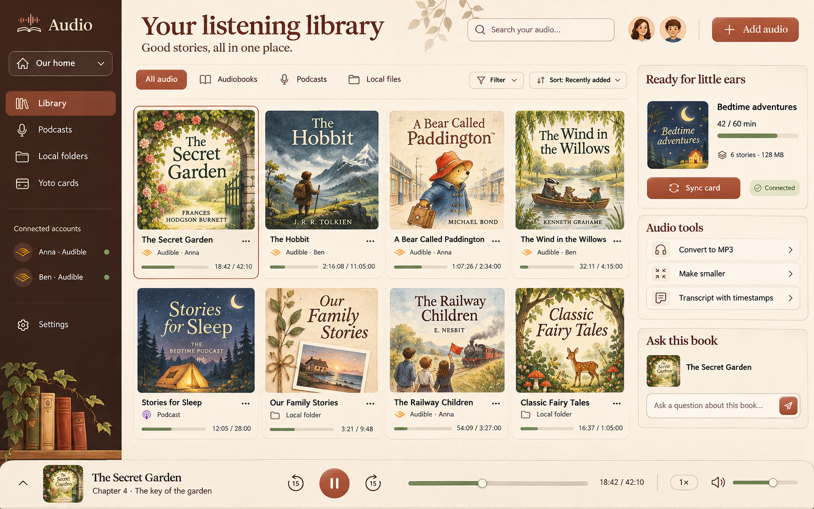

# Audio

A private family audio library at **https://audio.benlocher.com**. It does six things:

- Browses several people's **Audible** libraries side by side.
- Converts books you own to **MP3, one file per chapter**.
- Follows **podcasts** by Apple Podcasts link or RSS feed and downloads their episodes.
- Imports **folders of audio** from your computer.
- **Transcribes** any of it with timestamps, and answers questions about a book with Claude, using only the transcript **up to where you've listened**.
- Packs everything onto as few **Yoto Make-Your-Own cards** as possible and syncs them to your Yoto account.



## Stack

| Layer | Choice |
|---|---|
| API | Django 6.1 + Django Ninja, session auth (no sign-up; users are created on the server) |
| Database | PostgreSQL, both locally and in production |
| Background work | Celery + Redis. The thread pool works because the heavy lifting runs in ffmpeg subprocesses |
| Frontend | React 19 + TypeScript + Vite, TanStack Query, lucide icons |
| Audio | ffmpeg / ffprobe |
| Audible | [`audible`](https://github.com/mkb79/Audible) (mkb79): device registration, library, AAXC licences |
| Transcription | Groq Whisper (cheapest), OpenAI or Gemini; you pick the model each time ([`core/ai.py`](backend/core/ai.py)) |
| Ask about this book | Claude, OpenAI, Gemini, Grok or Groq; you pick the model in the chat. Claude gets prompt caching and server-side refusal fallback |
| Yoto | Yoto developer API: OAuth authorization code with PKCE (Yoto requires it even with a client secret), upload/transcode, `POST /content` |

Research notes behind the integrations are in [`docs/research/`](docs/research/).

### Why Postgres rather than SQLite

The server already runs Postgres. Celery workers write job progress at the same time as web requests, and SQLite's single writer lock gets in the way of that. Using Postgres locally too keeps development the same as production.

## Decisions worth knowing

**Bitrate.** MP3 at **64 kbps mono** is the built-in default; the one saved in Settings wins, and every bitrate picker starts on it. It's clear for speech and fine for light music. 48 kbps is still good for audiobooks, and 32 kbps starts to sound thin. Mono doesn't make a file smaller at the same bitrate (the size is bitrate × time). It makes speech clearer at low bitrates, because every bit goes to one channel. Presets run from 32 to 128 kbps.

**Yoto's real limits.** Each card holds up to 100 tracks, 500 MB and **5 hours**. Each track can be at most 100 MB and **60 minutes**.
- Yoto re-encodes every upload, so on long cards the 5-hour cap binds long before 500 MB does. Downsizing mostly speeds up uploads and saves disk space; it only fits more on a card when the source files are large.
- The packer enforces all of these limits and cuts tracks over 60 minutes into parts.
- You can turn the duration check off in Settings if it turns out not to be enforced.

**Packing.** Pick one or more sources (a whole Audible series is one click), put them in play order, and choose a strategy:
- **Back to back** (the default for several sources) plays everything in order, filling each card before starting the next, so when one book ends partway through a card the next begins on the same card. Greedy filling is provably the fewest cards possible without reordering. On a card shared by two books, each track is prefixed with its book ("Book 2 – Chapter 1"). Naming the set titles the cards "Name (3 of 24)".
- **New card per source** also keeps order, but starts every book or show on a fresh card.
- **Keep shows whole** splits each source into full cards and then bin-packs the leftovers (first-fit decreasing), so short shows can share a card.

**Spoilers.** "Ask" sends Claude only the transcript before your position. That position is either the player's position or a slider. Each question also goes out behind a fixed warning (folded to one line above the question box; tap it to read it): anything about the work comes only from the transcript, general background (word meanings, history, the period) is allowed, and nothing may point toward what happens next. Answers cite `[h:mm:ss]` timestamps, and clicking one plays from that moment.

**Ask on a phone.** Below 860 px wide, Ask is its own full screen: a top bar (back, conversations, new chat), a chip showing the spoiler limit and model that opens a bottom sheet for them, the conversation, and a small player for jumping to cited moments. Tapping the question pill opens a full-page composer that stays above the keyboard (it follows `visualViewport`, since iOS doesn't resize the page); sending returns you to the conversation as the answer streams in. The composer and sheets live in `?ask=…`, so the back gesture closes them. Every library book card has an **Ask** footer, which links to `/books/:id?tab=ask`.

**Asking by voice.** The mic records in the browser (webm/opus, or mp4 on Safari) and posts the clip to `/api/transcripts/dictate`. The clip is transcribed with the default transcription model, and the book's title goes along as a Whisper prompt so names come out spelled right.

**Make askable.** One button on each book (and on its card) runs a single job: download and convert at the **default bitrate from Settings**, then transcribe every chapter with the default transcription model. A book already converted at another bitrate is converted again only when none of its chapters is transcribed, because re-converting replaces the tracks and their transcripts.

**Audible.** Signing in takes two steps because Amazon has no web OAuth for third parties:
1. Open Amazon's sign-in link and log in.
2. Paste back the `…/ap/maplanding?…` URL Amazon lands on.

The account is then registered as a device, the same way the Audible app is. Removing it here deregisters the device. Books download as AAXC and are decrypted with the per-book voucher (no re-encode). The decrypted `.m4b` master is kept so you can re-convert at another bitrate without downloading again.

**Installable app (PWA).** The site installs as an app from Chrome/Edge (address bar or Settings → App on this device), Android ("Add to Home screen"), and iOS Safari (Share → Add to Home Screen).
- `frontend/public/manifest.webmanifest` holds the name, colors, icons (any, maskable, monochrome) and app shortcuts. The icon sources are the SVGs in `frontend/public/icons/`; the PNGs come from them via `rsvg-convert`.
- The service worker template is `frontend/pwa/sw.js`. The build (`pwaPlugin` in `vite.config.ts`) writes `dist/sw.js` with the precache list and a content-derived version, so every deploy ships a new worker. It only registers in production builds; use the `frontend-pwa` launch config (`vite preview` on 5184) to try it locally.
- Caching: the app shell is precached; pages load network-first and fall back to the cached shell after 4 s or when offline; `/api/` JSON is network-first with the last copy kept for offline; covers are stale-while-revalidate (capped at 400). Audio (`/api/media/`, range requests) is never cached. Signed-in caches are deleted on sign-out or session expiry.
- A new deploy shows "A new version of Audio is ready — Reload" instead of swapping code under an open tab.
- The player publishes Media Session metadata and actions, so lock screens, headphones and media keys control playback.

## Local development

You need Python 3.13 (via `uv`), Node 24+, Postgres, Redis and ffmpeg.

Double-click **`StartAudioDev.app`**. It opens iTerm with one pane each for:
- Redis on port 6390
- Django on port 8011
- Vite on port 5182
- Celery
- a working shell

The first run installs dependencies, creates `.env` and creates the `audio` database. Then open http://localhost:5182/.

To run it by hand:

```bash
uv venv --python 3.13 .venv && uv pip install -r backend/requirements-dev.txt
```

```bash
cp .env.example .env && createdb audio
```

```bash
.venv/bin/python backend/manage.py migrate && .venv/bin/python backend/manage.py createsuperuser
```

Start these, each in its own terminal:

- `redis-server --port 6390`
- `.venv/bin/python backend/manage.py runserver 127.0.0.1:8011`
- `cd backend && ../.venv/bin/celery -A config worker --pool threads`
- `npm run dev --prefix frontend`

Tests and lint:

```bash
.venv/bin/pytest -q && .venv/bin/ruff check backend && npm run build --prefix frontend
```

When the server can see your disk (local dev), folder import can also copy straight from paths listed in `LOCAL_IMPORT_ROOTS`.

## Keys and accounts (Settings page)

| What | Where it comes from |
|---|---|
| Audible | **Add account** for each person, then **Sign in** |
| AI provider keys | Any of Claude (Anthropic), OpenAI, Gemini, Grok (xAI) and Groq. Each key unlocks that provider's current models, listed live from its API. Claude and Grok are Ask-only; Anthropic and xAI offer no speech-to-text in this app |
| Yoto | Create a **confidential** app at [dashboard.yoto.dev](https://dashboard.yoto.dev). Register the callback `https://audio.benlocher.com/api/yoto/callback` (and `http://localhost:5182/api/yoto/callback` for dev). Paste the client ID and secret into Settings, then **Connect a Yoto account** |

Keys can also come from the environment (`OPENAI_API_KEY`, `ANTHROPIC_API_KEY`, `GEMINI_API_KEY`, `XAI_API_KEY`, `GROQ_API_KEY`, `YOTO_CLIENT_ID`, `YOTO_CLIENT_SECRET`).

**Transcription timestamps.** How precise the timestamps are depends on the model:
- Whisper models (Groq's `whisper-large-v3-turbo`/`-v3`, OpenAI's `whisper-1`) return a timestamp every few seconds.
- Gemini's transcribe model times each word, and the app groups the words into sentences.
- Models that return only text, such as `gpt-transcribe`, are cut into 2-minute pieces, so each piece's start is the timestamp.

**Ask on smaller models.** When the heard-so-far transcript doesn't fit the chosen model, the model sees the most recent stretch plus the earlier passages that best match the question. Groq is capped at a configurable 24k-token budget by default, because its per-minute token limits are far below its models' context windows. Everything stored in the database is Fernet-encrypted with `CREDENTIAL_ENCRYPTION_KEY`.

Once a card is synced, link the playlist to a physical card in the Yoto app (Library → playlist → Link to card); there is no API for that step.

## Production (dailyoffice)

It follows the same pattern as the other apps on the host (see [`deploy/`](deploy/)):

| Piece | Setting |
|---|---|
| Deploy | Push to a bare repo; its `post-receive` hook checks out `main`, installs Python and Node dependencies, builds React, migrates, collects static files and restarts both services |
| Services | `audio` (gunicorn + uvicorn on `127.0.0.1:8008`) and `audio-celery`, running as the `audioshelf` user |
| Config | `/etc/audio/audio.env` (secrets generated on the server) |
| Media | `/var/lib/audio/media`, served by nginx through `X-Accel-Redirect` only after Django checks the session. There is no public media URL |
| Database | Postgres database `audio`, Redis DB 5, TLS from Let's Encrypt via certbot |

To deploy:

```bash
git push dailyoffice main
```

To create a login on the server:

```bash
ssh -t dailyoffice 'cd /var/www/audio.benlocher.com/backend && set -a && . /etc/audio/audio.env && set +a && ../.venv/bin/python manage.py createsuperuser'
```

Logins are throttled (8 failed attempts per IP per 15 minutes).

## Caveats

- Audible has no public API. These endpoints are the ones the official apps use, and Amazon can change them. Keep `audible` up to date.
- Some Yoto API details are undocumented: the transcode polling endpoint and whether limits are enforced. The client is defensive, but treat the first sync as a test.
- Transcription costs $0.04 per hour on Groq `whisper-large-v3-turbo` and about $0.36 per hour on OpenAI `whisper-1`, which OpenAI retires in February 2027. The dialog shows an estimate where the provider publishes a price.
