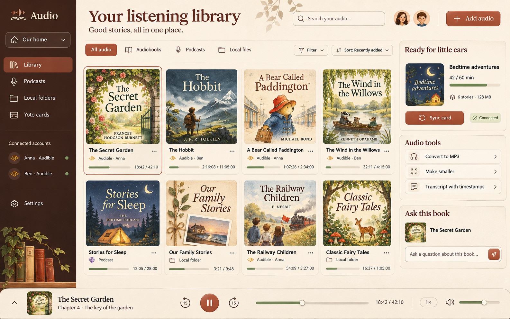

# Audio

A private family audio library at **https://audio.benlocher.com**. It does six things:

- Browses several people's **Audible** libraries side by side.
- Converts books you own to **MP3, one file per chapter**.
- Follows **podcasts** by Apple Podcasts link or RSS feed and downloads their episodes.
- Imports **folders of audio** from your computer.
- **Transcribes** any of it with timestamps, and answers questions about a book with Claude, using only the transcript **up to where you've listened**.
- Packs everything onto as few **Yoto Make-Your-Own cards** as possible and syncs them to your Yoto account.



## Stack

| Layer | Choice |
|---|---|
| API | Django 6.1 + Django Ninja, session auth (no open sign-up; super admins invite people by email) |
| Database | PostgreSQL, both locally and in production |
| Background work | Celery + Redis. The thread pool works because the heavy lifting runs in ffmpeg subprocesses |
| Frontend | React 19 + TypeScript + Vite, TanStack Query, lucide icons |
| Audio | ffmpeg / ffprobe |
| Audible | [`audible`](https://github.com/mkb79/Audible) (mkb79): device registration, library, AAXC licences |
| Transcription | Groq Whisper (cheapest), OpenAI or Gemini; you pick the model each time ([`core/ai.py`](backend/core/ai.py)) |
| Ask about this book | Claude, OpenAI, Gemini, Grok or Groq; you pick the model in the chat from a short list per provider (the newest *Best reasoning*, *Balanced* and *Fast* model, chosen in `core/ai.py` `CHAT_TIERS`). Claude gets prompt caching and server-side refusal fallback |
| Yoto | Yoto developer API: OAuth authorization code with PKCE (Yoto requires it even with a client secret), upload/transcode, `POST /content` |

Research notes behind the integrations are in [`docs/research/`](docs/research/).

### Why Postgres rather than SQLite

The server already runs Postgres. Celery workers write job progress at the same time as web requests, and SQLite's single writer lock gets in the way of that. Using Postgres locally too keeps development the same as production.

## Decisions worth knowing

**People and libraries (households).** Everything belongs to a *library*: its Audible and Yoto accounts, podcasts, folders, Yoto cards, AI keys and audio preferences. People in the same library share all of it; different libraries never see each other's books, cards, jobs or audio files (`/api/media/` checks the file's library). Ben and Elizabeth share the first library and are *super admins*.
- **Inviting.** Settings → People → **Invite someone** takes a name and email and asks one question: a library of their own (another family) or a share of yours (someone in your home). For their own library you can also let them use your AI keys; they can use them but never see them, and you can switch it off per library later. Invitations are emailed when `EMAIL_HOST` is set; either way the dialog shows the link to copy, plus a button that opens a pre-written email in your mail app. Links last 14 days and work once; inviting the same address again replaces the old link.
- **Accepting.** The link opens a page where they type their name and a password, and they're signed in. They sign in later with their email (older logins can still use a username).
- **Welcome wizard** (`/welcome`). New people land on it until they finish or skip it. It starts by asking what they want to do (Yoto cards, Ask about books, Listen here) and where their audio comes from (Audible, podcasts, their own files), then shows only the steps those need: Audible (any number of accounts, each labelled by whose it is, with the two-step Amazon sign-in, a paste button and plain-language help), following a podcast, Yoto (one button, back to the wizard), and the AI key for Ask, which says it's only needed for Transcribe and Ask and suggests one OpenAI key with click-by-click steps. It ends with a summary and a first thing to do. Anything already connected shows as done. Rerun it from Settings → Your setup, or open one step, e.g. `/welcome?step=ai`.
- **What the choices change.** They're stored per person (`Member.features`; empty means everything) and decide which setup steps the wizard shows, which shortcuts Home leads with ("Send a book to Yoto", "Ask about a book") and what the "Finish setting up" card on Home asks for. The menu and every feature stay available whatever was picked. They also decide which outcome buttons sit under each cover (Send to Yoto, Ask). Settings → Your setup changes them.
- **The menu teaches the order things happen in:** Home; *Your audio* (Library, then Audiobooks, Podcasts and My own files under it); *Make* (Yoto cards, with a hint that you start from the library); then Activity.
- **Home adapts.** With no audio yet it offers the ways in; with audio but no Yoto cards it shows "Your first Yoto card": three steps and their books right there, each with Send to Yoto; once books are transcribed it leads with "Ready to ask"; and it always shows what's starred and partway through.
- **Super admin dashboard** (`/superadmin`, in the menu for super admins): totals; invitations waiting, expired and accepted (copy link, resend, cancel); and for every library its people (last sign-in, still setting up, what they picked), whose AI keys it uses, Audible accounts, books, podcasts, folders, Yoto cards, storage, hours transcribed with an estimated cost, Ask answers and tokens, and failed background jobs.
- **View as** (dashboard or Settings → People): a super admin signs in as that person to see exactly what they see, with a bar across the top and "Back to my account". It doesn't change their "last signed in", it's logged, and what you change while viewing is changed for them.
- **Connecting to other sites.** Sign-ins on other sites happen in the same tab: the browser goes to the other site and comes straight back to the page it started from (with `?service=…&connected=1`, which the app turns into a "connected" message). Popups were tried first, but they opened behind the browser window and set off popup warnings, so people couldn't find them.
  - **OpenRouter** (`core/connect.py`) is the no-copy-paste way to set up Ask and Transcribe: its [OAuth PKCE sign-in](https://openrouter.ai/docs/use-cases/oauth-pkce) hands this app a key of the person's own (no app registration needed), saved to their library like any other key. It covers Claude, GPT and Gemini for Ask and Whisper (`openai/whisper-large-v3`) for transcription. Its transcription is treated as text-only, so audio goes in 2-minute pieces and each piece's start is the timestamp.
  - **Yoto** works the same way. Connecting from "Send to Yoto" on a book comes back to that book with the dialog open again.
  - **Pasting a key** (OpenAI and the rest) opens the key page in a new tab and, when the person comes back to the window, picks a copied `sk-…` key up from the clipboard (the browser may ask once); a Paste button covers browsers that don't allow that.
  - **Audible** still needs the copy-the-address step: Amazon only returns sign-ins to its own `maplanding` page, which another site can't read (pretending to be an iPad doesn't change that; the address is still Amazon's). The step shows a drawing of the "Page not found" page people will see, picks the address up from the clipboard when they come back to the tab (where the browser allows), and connects as soon as a right-looking address is pasted.
  - **OpenAI's own "Sign in with ChatGPT"** isn't used: for a hosted site it needs OpenAI's approval as a partner, and it doesn't cover transcription.
- **The Yoto developer app** is the site's, not a library's: a super admin sets it up once (Settings → Yoto), then everyone connects their own Yoto account with one button.
- **Server keys.** AI keys in the server's environment (`OPENAI_API_KEY`...) belong to the first library only, unless it shares its keys with another.
- **Migrating.** The `households` migrations put everything that existed into one library shared by all existing logins (who skip the wizard), and make users named Ben or Elizabeth super admins.

**Bitrate.** MP3 at **64 kbps mono** is the built-in default; the one saved in Settings wins, and every bitrate picker starts on it. It's clear for speech and fine for light music. 48 kbps is still good for audiobooks, and 32 kbps starts to sound thin. Mono doesn't make a file smaller at the same bitrate (the size is bitrate × time). It makes speech clearer at low bitrates, because every bit goes to one channel. Presets run from 32 to 128 kbps.

**Yoto's real limits.** A card holds **500 MB** and up to 100 tracks; each track can be at most 100 MB and 60 minutes. Yoto's docs also mention 5 hours per card, but it accepts far longer cards, so the site thinks of a card as 500 MB and shows how full each one is as a percentage. Smaller audio (a lower bitrate) fits more on a card.
- The packer enforces these limits and cuts tracks over 60 minutes into parts.

**Send to Yoto** is one button on every book, podcast and folder (on its page and under its cover). It opens one dialog that shows how many cards each audio size needs ("As is" and each preset), then a single background job (`yoto_send`) does everything: downloads and converts an Audible book if it isn't yet (straight at the chosen size), packs it onto cards, downsizes if asked, and uploads every card to Yoto. The dialog follows the job to a "You're all set" screen that explains the step people miss: the playlist waits in the Yoto app's Library to be linked to a blank card. "Try again" reuses the same cards (the browser picks the batch id).

**Packing** only comes up when several books or shows go on cards together (Yoto cards → "Put several books or shows on cards together"). Put them in play order and choose a strategy:
- **Back to back** (the default for several sources) plays everything in order, filling each card before starting the next, so when one book ends partway through a card the next begins on the same card. Greedy filling is provably the fewest cards possible without reordering. On a card shared by two books, each track is prefixed with its book ("Book 2 – Chapter 1"). Naming the set titles the cards "Name (3 of 24)".
- **Each on its own card** also keeps order, but starts every book or show on a fresh card.
- **Keep short ones whole** splits each book or show into full cards and then bin-packs the leftovers (first-fit decreasing), so short shows can share a card.

**Podcast seasons** work like books in a series. Each season is its own source, so the card picker lets you tick a whole show or just a season or two, and a set of seasons suggests the show's name for the cards. The podcast page groups episodes under season headers you can tick, and "Send to Yoto" there uses your selection. Episodes play in episode-number order when every episode in the season has one, otherwise by release date. A feed with no season numbers counts as one season; episodes with no season in a feed that otherwise has them (trailers, bonus episodes) go last as "Extras".

**Spoilers.** "Ask" sends Claude only the transcript before your position. That position is either the player's position or a slider. Each question also goes out behind a fixed warning (folded to one line above the question box; tap it to read it): anything about the work comes only from the transcript, general background (word meanings, history, the period) is allowed, and nothing may point toward what happens next. Answers cite `[h:mm:ss]` timestamps, shown with the chapter they fall in ("Ch. 12 · 3:41:07"), and clicking one slides the transcript up over the chat, opened on the cited line: scroll back and forth through it, tap a line's time to play from there, or press play to start from the citation and follow along line by line. Lines past that answer's spoiler limit stay blurred until you choose to show them or play that far. What answers can use has three settings: **Up to where I am** (the default), **Farthest I've been**, and **Whole book**. Audible only reports the last-heard position, so "farthest" is the highest position this app has seen at any Audible sync (or, for podcasts and folders, the farthest this device has played).

**Ask on a phone.** Below 860 px wide, Ask is its own full screen: a top bar (back, conversations, new chat), a chip showing the spoiler limit and model that opens a bottom sheet for them, the conversation, and a small player for jumping to cited moments. Tapping the question pill opens a full-page composer that stays above the keyboard (it follows `visualViewport`, since iOS doesn't resize the page); sending returns you to the conversation as the answer streams in. The composer and sheets live in `?ask=…`, so the back gesture closes them. Every library book card has an **Ask** footer, which links to `/books/:id?tab=ask`.

**Asking by voice.** The mic records in the browser (webm/opus, or mp4 on Safari) and posts the clip to `/api/transcripts/dictate`. The clip is transcribed with the default transcription model, and the book's title goes along as a Whisper prompt so names come out spelled right.

**Make askable.** One button on each book (and on its card) runs a single job: download and convert at the **default bitrate from Settings**, then transcribe every chapter with the default transcription model. A book already converted at another bitrate is converted again only when none of its chapters is transcribed, because re-converting replaces the tracks and their transcripts.

**Audible.** Signing in takes two steps because Amazon has no web OAuth for third parties:
1. Open Amazon's sign-in link and log in.
2. Paste back the `…/ap/maplanding?…` URL Amazon lands on.

The account is then registered as a device, the same way the Audible app is. Removing it here deregisters the device. Books download as AAXC and are decrypted with the per-book voucher (no re-encode). The decrypted `.m4b` master is kept so you can re-convert at another bitrate without downloading again.

**Installable app (PWA).** The site installs as an app from Chrome/Edge (address bar or Settings → App on this device), Android ("Add to Home screen"), and iOS Safari (Share → Add to Home Screen).
- `frontend/public/manifest.webmanifest` holds the name, colors, icons (any, maskable, monochrome) and app shortcuts. The icon sources are the SVGs in `frontend/public/icons/`; the PNGs come from them via `rsvg-convert`.
- The service worker template is `frontend/pwa/sw.js`. The build (`pwaPlugin` in `vite.config.ts`) writes `dist/sw.js` with the precache list and a content-derived version, so every deploy ships a new worker. It only registers in production builds; use the `frontend-pwa` launch config (`vite preview` on 5184) to try it locally.
- Caching: the app shell is precached; pages load network-first and fall back to the cached shell after 4 s or when offline; `/api/` JSON is network-first with the last copy kept for offline; covers are stale-while-revalidate (capped at 400). Audio (`/api/media/`, range requests) is never cached. Signed-in caches are deleted on sign-out or session expiry.
- A new deploy shows "A new version of Audio is ready — Reload" instead of swapping code under an open tab.
- The player publishes Media Session metadata and actions, so lock screens, headphones and media keys control playback.

## Local development

You need Python 3.13 (via `uv`), Node 24+, Postgres, Redis and ffmpeg.

Double-click **`StartAudioDev.app`**. It opens iTerm with one pane each for:
- Redis on port 6390
- Django on port 8011
- Vite on port 5182
- Celery
- a working shell

The first run installs dependencies, creates `.env` and creates the `audio` database. Then open http://localhost:5182/.

To run it by hand:

```bash
uv venv --python 3.13 .venv && uv pip install -r backend/requirements-dev.txt
```

```bash
cp .env.example .env && createdb audio
```

```bash
.venv/bin/python backend/manage.py migrate && .venv/bin/python backend/manage.py createsuperuser
```

Start these, each in its own terminal:

- `redis-server --port 6390`
- `.venv/bin/python backend/manage.py runserver 127.0.0.1:8011`
- `cd backend && ../.venv/bin/celery -A config worker --pool threads`
- `npm run dev --prefix frontend`

Tests and lint:

```bash
.venv/bin/pytest -q && .venv/bin/ruff check backend && npm run build --prefix frontend
```

When the server can see your disk (local dev), folder import can also copy straight from paths listed in `LOCAL_IMPORT_ROOTS`.

## Keys and accounts (Settings page)

| What | Where it comes from |
|---|---|
| Audible | **Add account** for each person, then **Sign in** (new people do this in the welcome wizard) |
| AI provider keys (per library, optional) | **Connect with OpenRouter** (one click, no key to copy), or any of Claude (Anthropic), OpenAI, Gemini, Grok (xAI) and Groq. Each key unlocks that provider's current models, listed live from its API. Claude and Grok are Ask-only; Anthropic and xAI offer no speech-to-text in this app |
| Yoto | A super admin creates a **confidential** app at [dashboard.yoto.dev](https://dashboard.yoto.dev) once. Register the callback `https://audio.benlocher.com/api/yoto/callback` (and `http://localhost:5182/api/yoto/callback` for dev). Paste the client ID and secret into Settings → Yoto. Then anyone can **Connect your Yoto account** |
| Invitation email (optional) | `EMAIL_HOST`, `EMAIL_PORT`, `EMAIL_HOST_USER`, `EMAIL_HOST_PASSWORD`, `DEFAULT_FROM_EMAIL` in the environment. Without them, invite links are copied and sent by hand |

Keys can also come from the environment (`OPENAI_API_KEY`, `ANTHROPIC_API_KEY`, `GEMINI_API_KEY`, `XAI_API_KEY`, `GROQ_API_KEY`, `YOTO_CLIENT_ID`, `YOTO_CLIENT_SECRET`).

**Transcription timestamps.** How precise the timestamps are depends on the model:
- Whisper models (Groq's `whisper-large-v3-turbo`/`-v3`, OpenAI's `whisper-1`) return a timestamp every few seconds.
- Gemini's transcribe model times each word, and the app groups the words into sentences.
- Models that return only text, such as `gpt-transcribe`, are cut into 2-minute pieces, so each piece's start is the timestamp.

**Ask on smaller models.** When the heard-so-far transcript doesn't fit the chosen model, the model sees the most recent stretch plus the earlier passages that best match the question. Groq is capped at a configurable 24k-token budget by default, because its per-minute token limits are far below its models' context windows. Everything stored in the database is Fernet-encrypted with `CREDENTIAL_ENCRYPTION_KEY`.

Once a card is synced, link the playlist to a physical card in the Yoto app (Library → playlist → Link to card); there is no API for that step.

## Production (dailyoffice)

It follows the same pattern as the other apps on the host (see [`deploy/`](deploy/)):

| Piece | Setting |
|---|---|
| Deploy | Push to a bare repo; its `post-receive` hook checks out `main`, installs Python and Node dependencies, builds React, migrates, collects static files and restarts both services |
| Services | `audio` (gunicorn + uvicorn on `127.0.0.1:8008`) and `audio-celery`, running as the `audioshelf` user |
| Config | `/etc/audio/audio.env` (secrets generated on the server) |
| Media | `/var/lib/audio/media`, served by nginx through `X-Accel-Redirect` only after Django checks the session. There is no public media URL |
| Database | Postgres database `audio`, Redis DB 5, TLS from Let's Encrypt via certbot |

To deploy:

```bash
git push dailyoffice main
```

People normally join by invitation (Settings → People). To create a login on the server instead:

```bash
ssh -t dailyoffice 'cd /var/www/audio.benlocher.com/backend && set -a && . /etc/audio/audio.env && set +a && ../.venv/bin/python manage.py createsuperuser'
```

Logins are throttled (8 failed attempts per IP per 15 minutes).

## Caveats

- Audible has no public API. These endpoints are the ones the official apps use, and Amazon can change them. Keep `audible` up to date.
- Some Yoto API details are undocumented: the transcode polling endpoint and whether limits are enforced. The client is defensive, but treat the first sync as a test.
- Transcription costs $0.04 per hour on Groq `whisper-large-v3-turbo` and about $0.36 per hour on OpenAI `whisper-1`, which OpenAI retires in February 2027. The dialog shows an estimate where the provider publishes a price.
